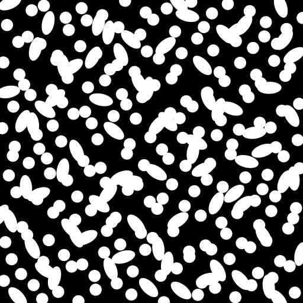
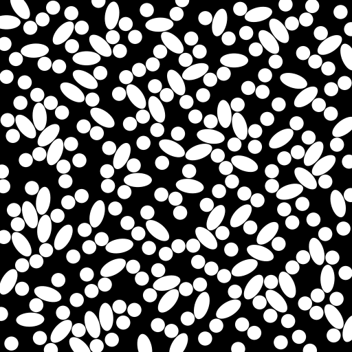
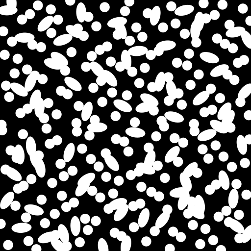

# ShapeForge

[](https://www.python.org/downloads/)
[](https://opensource.org/licenses/MIT)

A high-performance Python package for generating 2D and 3D Representative Volume Elements (RVE) and unit cells containing geometric inclusions following specified size, orientation, and spatial distributions.

---

## Installation

```bash
pip install shapeforge
```

Or for development with [uv](https://docs.astral.sh/uv/):

```bash
git clone https://github.com/338rajesh/shapeforge.git
cd shapeforge
uv sync
```

---

## Quick Start

### 1. Command-Line Interface (CLI)

Run cell generation directly from a YAML configuration file:

```bash
# Generate RVE with default configuration
shapeforge demo/config.yaml

# Run with verbose info/debug logging
shapeforge demo/config.yaml --log debug

# Profile execution to find bottlenecks
shapeforge demo/config.yaml --profile --profile-sort cumulative --profile-lines 25
```

### 2. Python API

```python
from pathlib import Path
from shapeforge.main import generate_cell_2d
from shapeforge.cell import Cell

# Generate cells using a configuration file or mapping
cells = generate_cell_2d("demo/config.yaml")

# Each cell pair contains (initial_cell, final_optimized_cell)
initial_cell, final_cell = cells[0]

# Inspect properties
print(f"Number of inclusions: {len(final_cell.shapes)}")
print(f"Domain area: {final_cell.domain.area:.2f}")
print(f"Inclusions area: {final_cell.shapes.area:.2f}")
print(
    f"Actual volume fraction: {final_cell.shapes.area / final_cell.domain.area:.4f}"
)

# Save or plot programmatically
final_cell.save("output/cell_0.json", overwrite=True)
final_cell.plot(
    "output/cell_0.png", size=(512, 512), background=0, foreground=255, dpi=100
)
```

| Initial Random Cell | Optimized Non-Overlapping Cell |
| :-----------------: | :----------------------------: |
|  |  |
|  |  |


---

## Key Features

- **Geometric Inclusions**: Circular and non-circular shapes (such as `Circle`, `Ellipse`), with constant or statistical parameter distributions (via `scipy.stats`).
- **High-Performance Overlap Optimization**:
  - Vectorized distance queries with `scipy.spatial.cKDTree` and analytical gradients.
  - Non-Monotone Spectral Projected Gradient (`nmspg`) optimization engine for fast, robust overlap resolution.
- **Advanced Spatial Initialization**:
  - Spatial point initialization with `uniform` random sampling, **Latin Hypercube Sampling (`lhs`)**, or **Sobol low-discrepancy sequences (`sobol`)** via `scipy.stats.qmc`.
- **Exact Volume Fraction Bounds**:
  - Option to dynamically scale domain bounds (`packing.adjust_bounds_to_exact_vf`) to achieve exact target volume fractions.
- **Config-Driven Multi-Format Export**:
  - Raster images: `.png`, `.jpg`, `.pdf` with customizable dimensions, DPI, background, and facecolor.
  - Cell serialization: `.json`, `.yaml`, `.pkl`, and `.npz` with lossless round-trip saving and loading (`Cell.save()` / `Cell.load()`).
  - Raw microstructure arrays: `.npy` binary arrays ready for machine learning and finite element pipelines.
  - Diagnostic convergence curves: Automatically plots objective function and gradient norm histories.
- **Built-in Profiling Suite**:
  - Profile runs anytime with `--profile` to pinpoint hotspots in execution time and memory. Compatible with [SnakeViz](https://jiffyclub.github.io/snakeviz/).


---

## Configuration File Structure

ShapeForge is completely driven by declarative YAML configuration files:

```yaml
# ============================================================================
# ShapeForge Configuration
# ============================================================================

num_cells: 1

metadata:
  title: shapeforge-demo
  rng_seed: 42
  log_level: info        # debug | info | warning | error

domain:
  shape: rectangle
  bounds:
    x_min: 0.0
    y_min: 0.0
    x_max: 50.0
    y_max: 50.0

shapes:
  - name: Circle
    volume_fraction: 0.25
    params:
      radius: 1.0         # constant or distribution, e.g. uniform(1.0, 0.2)
  - name: Ellipse
    volume_fraction: 0.20
    params:
      semi_major_length: 2.0
      semi_minor_length: 1.0
      major_axis_angle: uniform(0.0, 1.0)

packing:
  periodicity: false
  min_gap_ratio: 0.05
  proj_buffer_ratio: 2.0
  adjust_bounds_to_exact_vf: false

solver:
  init_method: uniform   # uniform | lhs | sobol
  optimiser:
    name: nmspg
    max_iter: 1000
    epsilon: 1.0e-6

export:
  output_dir: ./scratch/outputs/test_1
  as_array: false        # save raw uint8 array as .npy
  formats:               # png, jpg, pdf, json, pkl, yml, npz
    - png
    - json
  background: 0
  facecolor: 255
  image_dimensions: [512, 512]
  dpi: 100
```

---

## Architecture

A **Cell** consists of:
- **Domain**: Spatial boundary (e.g. `CellDomain2D` with rectangular bounds).
- **Inclusions**: Collection of shapes (`Inclusions2D`) containing `gb.Shape2D` objects.
  - **Positional parameters**: Centroid coordinates $(x, y)$ and orientation angle $\theta$. These are optimized by the solver while preserving shape sizes.
  - **Size parameters**: Semi-major length, semi-minor length, radius, etc. Defined either as fixed numbers or continuous distributions (`norm`, `uniform`, `lognorm`, etc.).

---

## Profiling & Performance Diagnostics

ShapeForge includes an integrated profiler. You can profile any generation run to analyze runtime hotspots:

```bash
# Profile and display the top 20 cumulative time hotspots
shapeforge demo/config.yaml --profile --profile-sort cumulative --profile-lines 20

# Visualize binary profile with SnakeViz
snakeviz scratch/outputs/test_1/shapeforge.prof
```

---

## Testing

Run the test suite with `pytest`:

```bash
pytest -v
```

---

## License

This project is licensed under the MIT License - see the LICENSE file for details.
