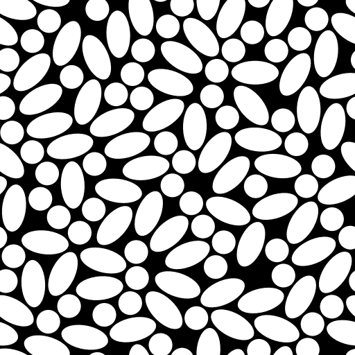

.. ShapeForge documentation master file

======================================
ShapeForge Documentation
======================================

**ShapeForge** is a high-performance Python package for generating 2D (and extensible to 3D) geometric domains packed with inclusions of arbitrary shapes, sizes, and orientations according to prescribed volume fractions and statistical distributions.

It is designed for computational mechanics, materials science, and physics simulations requiring realistic Representative Volume Elements (RVEs) and periodic unit cells.

Key Features
============

* **Multi-Phase Geometric Shapes**:
  Out-of-the-box support for circles and ellipses via ``gbox``, with an extensible custom shape architecture via ``@register_shape``.
* **Arbitrary Statistical Distributions**:
  Control shape dimensions, aspect ratios, and orientations using continuous distributions from ``scipy.stats`` (e.g. ``uniform``, ``norm``, ``lognorm``).
* **Advanced Initial Sampling**:
  Choose between pseudorandom uniform sampling, Latin Hypercube Sampling (LHS), and Sobol low-discrepancy quasi-Monte Carlo sequences.
* **Fast Overlap Minimization**:
  Powered by the Non-monotone Spectral Projected Gradient (**NM-SPG**) algorithm with Barzilai-Borwein adaptive step sizing and $k$-d tree accelerated broad-phase contact detection.
* **Rigorous Periodic Boundary Conditions (PBC)**:
  Full toroidal topology wrapping with automatic ghost copy generation across edges and corners for continuous periodic tessellation.
* **Integrated Profiling & Diagnostics**:
  Deterministic ``cProfile`` context manager producing terminal hotspot reports and ``.prof`` files compatible with SnakeViz, Tuna, and VS Code.
* **Multi-Format Serialization**:
  Export microstructures to PNG, JPEG, PDF, JSON, YAML, Pickle, and NumPy NPZ arrays.

Installation
============

Requirements
------------
* Python >= 3.14
* NumPy >= 2.0
* SciPy >= 1.12
* Matplotlib >= 3.8
* PyYAML >= 6.0
* gbox == 1.3.0

Installing via pip
------------------

Install the latest release from PyPI:

.. code-block:: bash

   pip install shapeforge

Installing from Source
----------------------

To install the latest development version directly from GitHub:

.. code-block:: bash

   git clone https://github.com/338rajesh/shapeforge.git
   cd shapeforge
   pip install .

Quickstart
==========

ShapeForge can be used either as a command-line utility or directly as a Python library.

1. Create a Configuration File
------------------------------

Save the following minimal configuration as ``config.yaml``:

.. code-block:: yaml

   num_cells: 1
   metadata:
     title: quickstart-demo
     rng_seed: 42
     log_level: info

   domain:
     shape: rectangle
     bounds:
       x_min: 0.0
       y_min: 0.0
       x_max: 20.0
       y_max: 20.0

   shapes:
     - name: Circle
       volume_fraction: 0.25
       params:
         radius: uniform(0.8, 0.4)

     - name: Ellipse
       volume_fraction: 0.15
       params:
         semi_major_length: 1.5
         semi_minor_length: 0.8
         major_axis_angle: uniform(0.0, 3.14159)

   packing:
     periodicity: true
     min_gap_ratio: 0.05
     proj_buffer_ratio: 1.0
     adjust_bounds_to_exact_vf: false

   solver:
     init_method: sobol
     optimiser:
       name: nmspg
       iter_max: 1000
       iter_memory: 10
       epsilon: 1.0e-6

   export:
     output_dir: ./output
     as_array: false
     formats:
       - png
       - json
     background: 0
     facecolor: 255
     image_dimensions: [512, 512]
     dpi: 150

2. Run the CLI Command
----------------------

Execute the ``shapeforge`` command pointing to your YAML file:

.. code-block:: bash

   shapeforge config.yaml

Output logs will display the iteration progress, final overlap potential $f$, and wall-clock execution time. The generated cells and diagnostic plots will be written to ``./output/``.

3. Programmatic Python API
--------------------------

You can also generate and manipulate unit cells interactively in Python or Jupyter notebooks:

.. code-block:: python

   from shapeforge import generate_cell_2d

   # Generate microstructures from configuration
   cells = generate_cell_2d("config.yaml")

   # Retrieve the generated pair (initial unrelaxed cell, final relaxed cell)
   initial_cell, final_cell = cells[0]

   print(f"Number of packed inclusions: {len(final_cell.shapes)}")
   print(f"Total inclusion area: {final_cell.shapes.area:.2f}")

   # Render and save plot
   final_cell.plot("my_cell.png", size=(512, 512), background=0, foreground=255)

Documentation Contents
======================

.. toctree::
   :maxdepth: 2
   :caption: User Guide & References

   config_reference
   cli_reference
   api_reference
   examples

